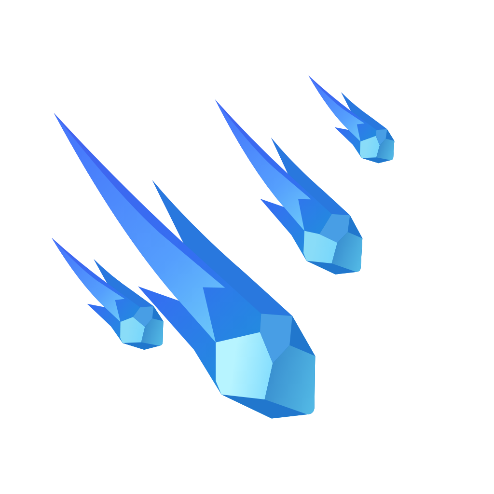
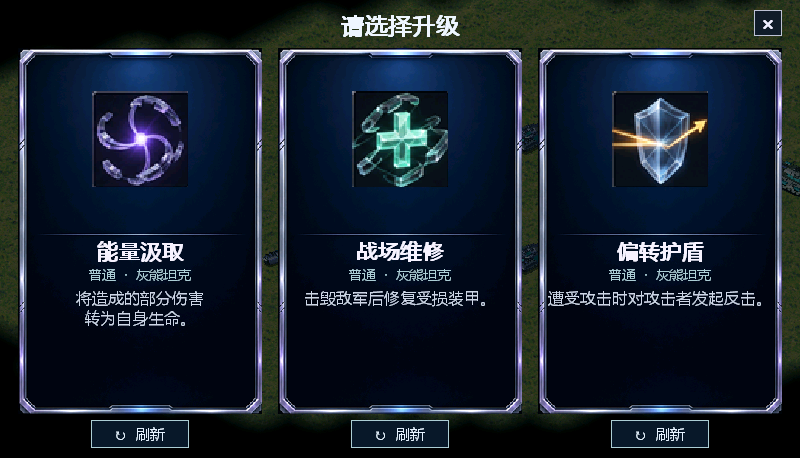

# Starfall Lab / 流火实验室



Starfall Lab（流火实验室，简称流火）是《红色警戒 2：尤里的复仇》的 32 位 DLL 扩展。通过 INI 配置单位被动、科研选项、国家限制和前置项目。玩家可通过地图触发器或建筑获取科研点，每 100 点购买一项研究。

当前版本：**0.40**。支持事件触发与持续状态、可叠加被动、信号联动，以及可配置的科研三选一。自定义点选超武可用 `Type=ActionSequence` 执行 INI 结果和 Lua 脚本。[超武配置说明](docs/manual.html#super-action-sequence) · [0.40 中文规则手册](https://windswhisper.github.io/starfall/docs/zh-cn/starfall.html)



*科研界面示意，具体项目与效果由 INI 配置决定。*

项目名称已更新，现有的 `Starfall.dll`、`Starfall.ini` 和 INI 中的 `Starfall.*` 字段继续使用原名称，以兼容已有配置和存档。

## 在 Windows 上编译

**ActSp 特殊行为子模块**随 `Starfall.dll` 一起构建，提供飞行子机巡逻、建筑地面守卫、高级驻军和可建造高台。[配置与示例](modules/ActSp/README.md)

**ArtSp 视觉效果子模块**随同一 DLL 提供武器曳光。在 `rulesmd.ini` 的武器段引用样式，在 `artmd.ini` 定义颜色、长度、宽度与速度。[曳光配置](docs/manual/artsp.md)

安装 Git 和 Visual Studio 2022（Community 或 Build Tools）。勾选“使用 C++ 的桌面开发”，包含 MSVC v143 x86/x64 工具和 Windows SDK。编译本身无需安装游戏。

```bat
git clone --recurse-submodules https://github.com/windswhisper/starfall.git
cd starfall
.\build.cmd
```

产物为 `build\Starfall.dll`。如果已普通克隆仓库，可直接运行脚本补齐 YRpp。更新源码后用 `git submodule update --init` 同步依赖到项目记录的提交。GitHub 的 Download ZIP 不含子模块，请使用 Git 克隆。

源码职责、状态所有权和模块构建清单见 [模块边界说明](docs/architecture.md)。

## 运行与测试

流火加载时要求 `gamemd.exe` 的 CRC 为 `0x54CC0A13`；不匹配时会拒绝加载。游戏本体及加载器需自行准备。

### Ares 与 Phobos 兼容性

- **Ares**：可与公版 Ares 配合使用，流火的单位转换不依赖 Ares。永久心控免疫针对 Ares 3.0p1 适配；其他版本或构建的兼容性需要验证，不匹配时会在 `Starfall.log` 记录。
- **Phobos**：可与公版 Phobos 配合使用。步兵、载具和飞行器转换优先调用 `ConvertToType_Phobos`。未加载 Phobos、版本缺少该接口，或接口明确返回未实现时，自动使用流火内置转换，并执行其类型、载员和单位状态检查。内置转换支持携带 Ares 自定义子机和导弹的移动母体。不同版本和其他扩展组合的兼容性需要分别验证。

1. 把编译出的 `Starfall.dll` 放在游戏根目录，与 `gamemd.exe` 同级。可在游戏实际加载的 `rulesmd.ini` 中配置流火，也可自行创建 `Starfall.ini`。默认科研面板、图标和示例音效已打包在 DLL 中，无需另行复制。自定义 PNG 图标和 WAV 音效需按配置放置。
2. 使用与所选扩展版本匹配的 Syringe 或 SyringeEx 启动游戏。与 Phobos 同时使用时，应让 Starfall 先于 Phobos 加载，以保持心控免疫生效。战场右上角的图标打开科研面板。
3. 可选：将 [tests/maps](tests/maps) 中的地图放入客户端的 `Maps/Custom/`。在 `Starfall - Research Points Test` 选择 1 号出生位，地图触发器先给 90 点，在 `[CAHOSP]` 配置 `Starfall.ResearchPoints=10` 和 `Starfall.ResearchInterval=150` 后，科技医院运行 150 帧即可补齐到 100 点。

从双 DLL 版本升级时，将旧 `ActSp.dll` 移出游戏目录，并删除启动配置中的 `-i=ActSp.dll`。原有特殊行为配置可直接使用。

查字段、默认值和配置示例，可以访问 [在线规则手册](https://windswhisper.github.io/starfall/docs/manual.html)，也可以下载项目后用浏览器打开 [中文 HTML 查询手册](docs/zh-cn/starfall.html)。面向 AI 和模组开发者的 [英文 Markdown 参考手册](docs/manual.md) 按当前实现整理了字段类型、默认值、适用范围、Lua 接口和配置示例。保持科研项目 ID 稳定可以让后续版本继续识别存档中的研究记录。

其他 32 位游戏扩展可调用 `Starfall_GetOwnedResearch`，按玩家读取已获得的科研项目 ID。[公共头文件](src/StarfallAPI.h) · [调用示例](docs/manual.md#native-research-query)

例如，下面的 `Starfall.ini` 让灰熊坦克每击杀一个敌人恢复 50 点生命：

```ini
[Starfall.PassiveTypes]
0=SF_KillRepair

[SF_KillRepair]
Trigger=OnKill
Filter.TargetHouse=Enemies
Action=Heal
Action.Amount=50

[MTNK]
Starfall.Passives=SF_KillRepair
```

把示例合并到现有配置时，请使用空闲的注册编号，并把被动 ID 追加到单位已有的 `Starfall.Passives` 列表。新的入门示例分别演示击杀触发、科研三选一和武器脚本。每个示例都有安装方法和实机观察步骤。[示例目录](examples/README.md)

## 源码与依赖

- `src/` 是正式 DLL 源码，`assets/research/` 提供科研界面美术。
- `assets/sound/`、`assets/research/` 中的内置资源由构建脚本打包进 DLL；`examples/` 包含可直接试用的配置和 Lua 脚本。
- 独立的实机测试、配置和地图在 [tests/](tests/README.md)。
- Lua 5.4.8 运行库取自 [Lua 官方源码标签](https://github.com/lua/lua/tree/v5.4.8)，源码与许可保存在 `references/lua/`，构建时静态链接进 DLL。
- [YRpp](https://github.com/Phobos-developers/YRpp) 通过 Git 子模块固定版本，提供编译所需的游戏接口头文件。项目开发参考了 [Phobos](https://github.com/Phobos-developers/Phobos)。
- Starfall Lab 自有代码采用 GNU 宽通用公共许可证第 3 版（`LGPL-3.0-only`）。完整条款见 [LGPLv3 正文](LICENSE) 和其引用的 [GPLv3 正文](COPYING)。外部依赖保留其上游声明。游戏本体、第三方 DLL 和加载器需自行准备。
