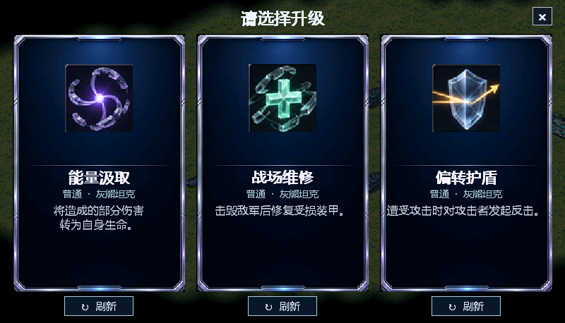

# Starfall Lab / 流火实验室


Starfall Lab（流火实验室，简称流火）是《红色警戒 2：尤里的复仇》的 32 位 DLL 扩展。通过 INI 配置单位被动、科研选项、国家限制和前置项目。玩家可通过地图触发器或建筑获取科研点，每 100 点购买一项研究。

当前版本：**0.36**。支持事件触发与持续状态、可叠加被动、信号联动，以及可配置的科研三选一。自定义点选超武可用 `Type=ActionSequence` 执行 INI 结果和 Lua 脚本。[超武配置示例](examples/ActionSequence/Rules.ini) · [规则手册](https://windswhisper.github.io/starfall/docs/manual.html)



*科研界面示意，具体项目与效果由 INI 配置决定。*

项目名称已更新，现有的 `Starfall.dll`、`Starfall.ini` 和 INI 中的 `Starfall.*` 字段继续使用原名称，以兼容已有配置和存档。

## 在 Windows 上编译

安装 Git 和 Visual Studio 2022（Community 或 Build Tools）。勾选“使用 C++ 的桌面开发”，包含 MSVC v143 x86/x64 工具和 Windows SDK。编译本身无需安装游戏。

```bat
git clone --recurse-submodules https://github.com/windswhisper/starfall.git
cd starfall
.\build.cmd
```

产物为 `build\Starfall.dll`。如果已普通克隆仓库，可直接运行脚本补齐 YRpp。更新源码后用 `git submodule update --init` 同步依赖到项目记录的提交。GitHub 的 Download ZIP 不含子模块，请使用 Git 克隆。

源码职责、状态所有权和模块构建清单见 [模块边界说明](docs/architecture.md)。

## 运行与测试

流火加载时要求 `gamemd.exe` 的 CRC 为 `0x54CC0A13`；不匹配时会拒绝加载。游戏本体及加载器需自行准备。

### Ares 与 Phobos 兼容性

- **Ares**：可与公版 Ares 配合使用，流火的单位转换不依赖 Ares。永久心控免疫针对 Ares 3.0p1 适配；其他版本或构建的兼容性需要验证，不匹配时会在 `Starfall.log` 记录。
- **Phobos**：可与公版 Phobos 配合使用。未加载 Phobos 时，单位转换使用流火的内置实现；加载 Phobos 时，需要该版本提供 `ConvertToType_Phobos` 公共接口。若接口不存在，单位转换不可用，并在 `Starfall.log` 记录原因。不同版本和其他扩展组合的兼容性需要分别验证。

1. 把编译出的 `Starfall.dll` 放在游戏根目录，与 `gamemd.exe` 同级。可在游戏实际加载的 `rulesmd.ini` 中配置流火，也可自行创建 `Starfall.ini`。默认科研面板、图标和示例音效已打包在 DLL 中，无需另行复制。自定义 PNG 图标和 WAV 音效需按配置放置。
2. 使用与所选扩展版本匹配的 Syringe 或 SyringeEx 启动游戏。与 Phobos 同时使用时，应让 Starfall 先于 Phobos 加载，以保持心控免疫生效。战场右上角的图标打开科研面板。
3. 可选：将 [tests/maps](tests/maps) 中的地图放入客户端的 `Maps/Custom/`。在 `Starfall - Research Points Test` 选择 1 号出生位，地图触发器先给 90 点，在 `[CAHOSP]` 配置 `Starfall.ResearchPoints=10` 和 `Starfall.ResearchInterval=150` 后，科技医院运行 150 帧即可补齐到 100 点。

查字段、默认值和配置示例，可以访问 [在线规则手册](https://windswhisper.github.io/starfall/docs/manual.html)，也可以下载项目后用浏览器打开 [中文 HTML 查询手册](docs/manual.html)。面向 AI 和模组开发者的 [英文 Markdown 参考手册](docs/manual.md) 按当前实现整理了字段类型、默认值、适用范围、Lua 接口和配置示例。保持科研项目 ID 稳定可以让后续版本继续识别存档中的研究记录。

例如，下面的 `Starfall.ini` 让灰熊坦克每击杀一个敌人恢复 50 点生命：

```ini
[Starfall.PassiveTypes]
0=SF_KillRepair

[SF_KillRepair]
Trigger=OnKill
Filter.TargetHouse=Enemies
Action=Heal
Action.Amount=50

[MTNK]
Starfall.Passives=SF_KillRepair
```

把示例合并到现有配置时，请使用空闲的注册编号，并把被动 ID 追加到单位已有的 `Starfall.Passives` 列表。更多科研配置见 [海克斯玩法示例](examples/Starfall.HexBrawl.ini)。

## Lua 技能

将 [示例 INI](examples/Lua/Starfall.ini) 合并到现有配置，把这四个示例的 .lua 文件复制到游戏根目录。INI 定义兵种、触发、冷却和技能数值，Lua 函数通过 `ctx.params` 读取自定义参数。例如部署美国大兵时，[FieldCommander.lua](examples/Lua/FieldCommander.lua) 会晋升范围内可训练的友军。[事件技能参数](https://windswhisper.github.io/starfall/docs/manual.html#lua-skills)

[ActiveBarrage.lua](examples/Lua/ActiveBarrage.lua) 和 [DirectionalShot.lua](examples/Lua/DirectionalShot.lua) 为灰熊和 V3 添加左下角主动技能按钮。前者选圆心，由最近的一辆车轰炸；后者选方向，所有就绪车辆分别发射炮弹。[主动技能参数](https://windswhisper.github.io/starfall/docs/manual.html#lua-active)

[龙卷风示例](examples/Tornado/Starfall.ini) 给灰熊增加选方向发射的主动技能。将 [Tornado.lua](examples/Tornado/Tornado.lua) 放入游戏根目录，把示例的注册项和技能段合并到规则，并将 `SF_Tornado` 追加到灰熊的被动列表。选中灰熊并点击一个方向。风眼默认在车前 5 格形成，沿直线推进到距发射点 18 格处，遇地图边缘缩短行程。每 2 帧卷入沿途半径 4 格内的步兵和载具，不分阵营，最多同时携带 12 个。最早卷入的单位在 96 帧内绕移动风眼旋转 5 圈，后来卷入的单位随风走完剩余路程。VXL 载具朝位移方向倾斜，风停后用 12 帧落地。每 6 帧对已卷入单位和此时风眼内的建筑造成 12 点基础伤害，共 16 次；建筑留在原位。

[AreaBarrage.lua](examples/Lua/AreaBarrage.lua) 演示定时回调和同步随机。V3 开火后锁定目标区域，每 4 帧引爆一次，共 20 次。任务和已抽取的随机进度可存读档。[定时任务接口](https://windswhisper.github.io/starfall/docs/manual.html#lua-timers)

## 源码与依赖

- `src/` 是正式 DLL 源码，`assets/research/` 提供科研界面美术。
- `assets/sound/`、`assets/research/` 中的内置资源由构建脚本打包进 DLL；`examples/` 包含示例配置和外部图标。
- 独立的实机测试、配置和地图在 [tests/](tests/README.md)。
- Lua 5.4.8 运行库取自 [Lua 官方源码标签](https://github.com/lua/lua/tree/v5.4.8)，源码与许可保存在 `references/lua/`，构建时静态链接进 DLL。
- [YRpp](https://github.com/Phobos-developers/YRpp) 通过 Git 子模块固定版本，提供编译所需的游戏接口头文件。项目开发参考了 [Phobos](https://github.com/Phobos-developers/Phobos)。
- Starfall Lab 的许可证见 [LICENSE](LICENSE)。外部依赖保留其上游声明。游戏本体、第三方 DLL 和加载器需自行准备。
