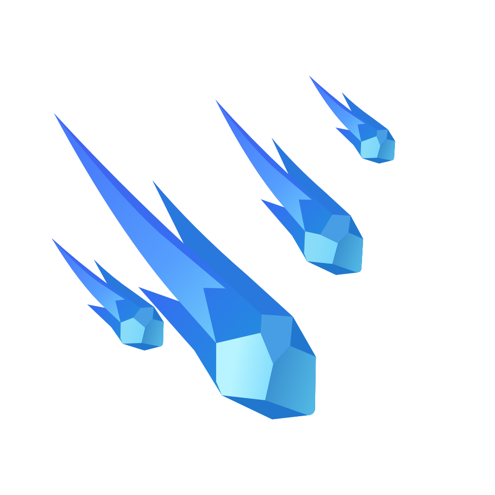

# Starfall Lab / 流火实验室



Starfall Lab（流火实验室，简称流火）是《红色警戒 2：尤里的复仇》的 32 位 DLL 扩展。通过 INI 配置单位被动、科研选项、国家限制和前置项目。玩家可通过地图触发器或建筑获取科研点，每 100 点购买一项研究。

当前版本：**0.35**。支持事件触发与持续状态、可叠加被动、信号联动，以及可配置的科研三选一。完整参数见规则手册。

项目名称已更新，现有的 `Starfall.dll`、`Starfall.ini` 和 INI 中的 `Starfall.*` 字段继续使用原名称，以兼容已有配置和存档。

## 在 Windows 上编译

安装 Git 和 Visual Studio 2022（Community 或 Build Tools）。勾选“使用 C++ 的桌面开发”，包含 MSVC v143 x86/x64 工具和 Windows SDK。编译本身无需安装游戏。

```bat
git clone --recurse-submodules https://github.com/windswhisper/starfall.git
cd starfall
.\build.cmd
```

产物为 `build\Starfall.dll`。如果已普通克隆仓库，可直接运行脚本补齐 YRpp。更新源码后用 `git submodule update --init` 同步依赖到项目记录的提交。GitHub 的 Download ZIP 不含子模块，请使用 Git 克隆。

## 运行与测试

当前版本针对《远征》测试环境的 `gamemd.exe`（Syringe 报告的 CRC 为 `0x54CC0A13`）。流火会在加载时检查此值。单位转换不再要求 Ares：未加载 Phobos 时使用流火内置转换；加载 Phobos 时需要它提供 `ConvertToType_Phobos` 公共接口。Phobos Dev Build #36 不提供该接口；已验证的新版开发构建提供该接口。其他游戏版本和扩展组合需另行验证。

1. 把编译出的 `Starfall.dll` 放在游戏根目录，与 `gamemd.exe` 同级。可在游戏实际加载的 `rulesmd.ini` 中配置流火，也可自行创建 `Starfall.ini`。默认科研面板、图标和示例音效已打包在 DLL 中，无需另行复制。自定义 PNG 图标和 WAV 音效需按配置放置。
2. 使用与 Phobos 版本匹配的 Syringe 启动游戏。新版 SyringeEx 需要通过 `--args="-SPAWN -LOG -CD"` 传递游戏参数；当前《远征》测试环境须让 Starfall 先于 Phobos 加载，以保持心控免疫生效。战场右上角的图标打开科研面板。
3. 可选：将 [tests/maps](tests/maps) 中的地图放入客户端的 `Maps/Custom/`。在 `Starfall - Research Points Test` 选择 1 号出生位，地图触发器先给 90 点，在 `[CAHOSP]` 配置 `Starfall.ResearchPoints=10` 和 `Starfall.ResearchInterval=150` 后，科技医院运行 150 帧即可补齐到 100 点。

查字段、默认值和配置示例，可下载项目后用浏览器打开 [HTML 查询手册](docs/规则说明书.html)，或直接阅读 [Markdown 说明书](docs/规则说明书.md)。保持科研项目 ID 稳定可以让后续版本继续识别存档中的研究记录。

例如，下面的 `Starfall.ini` 让灰熊坦克每击杀一个敌人恢复 50 点生命：

```ini
[Starfall.PassiveTypes]
0=SF_KillRepair

[SF_KillRepair]
Trigger=OnKill
Filter.TargetHouse=Enemies
Action=Heal
Action.Amount=50

[MTNK]
Starfall.Passives=SF_KillRepair
```

把示例合并到现有配置时，请使用空闲的注册编号，并把被动 ID 追加到单位已有的 `Starfall.Passives` 列表。更多科研配置见 [海克斯玩法示例](examples/Starfall.HexBrawl.ini)。

## 源码与依赖

- `src/` 是正式 DLL 源码，`assets/research/` 提供科研界面美术。
- `assets/sound/`、`assets/research/` 中的内置资源由构建脚本打包进 DLL；`examples/` 包含示例配置和外部图标。
- 独立的实机测试、配置和地图在 [tests/](tests/README.md)。本地验证记录保存在 `tests/local/`。
- [YRpp](https://github.com/Phobos-developers/YRpp) 通过 Git 子模块固定版本，提供编译所需的游戏接口头文件。项目开发参考了 [Phobos](https://github.com/Phobos-developers/Phobos)。
- Starfall Lab 的许可证见 [LICENSE](LICENSE)。外部依赖保留其上游声明。游戏本体、第三方 DLL 和加载器需自行准备。
